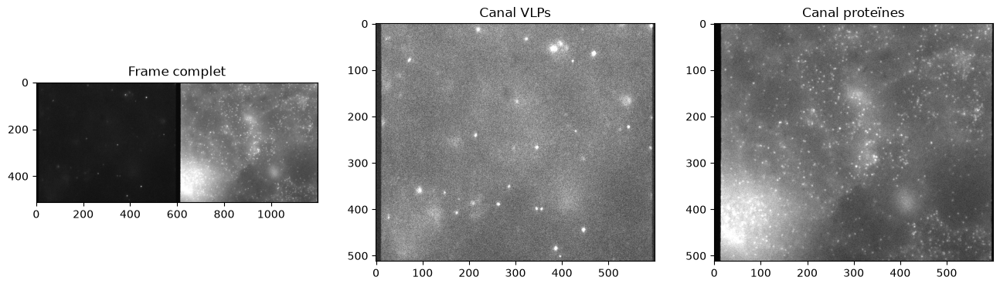
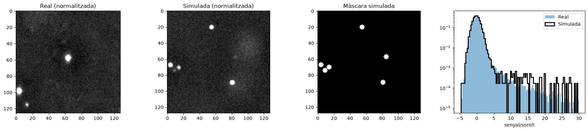
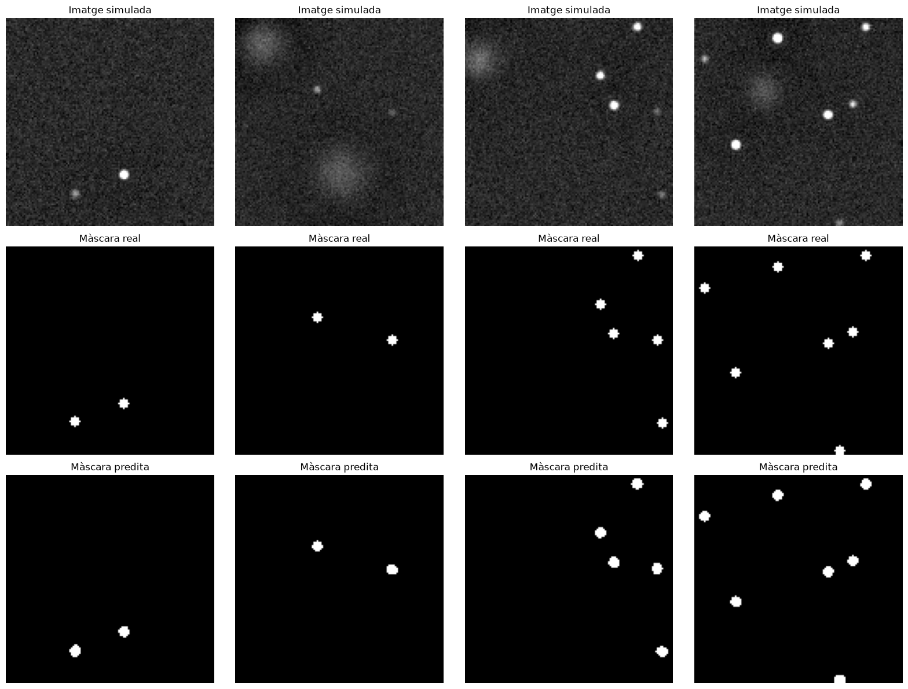
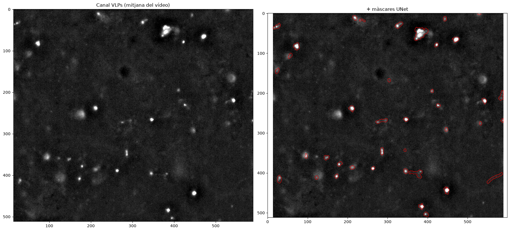
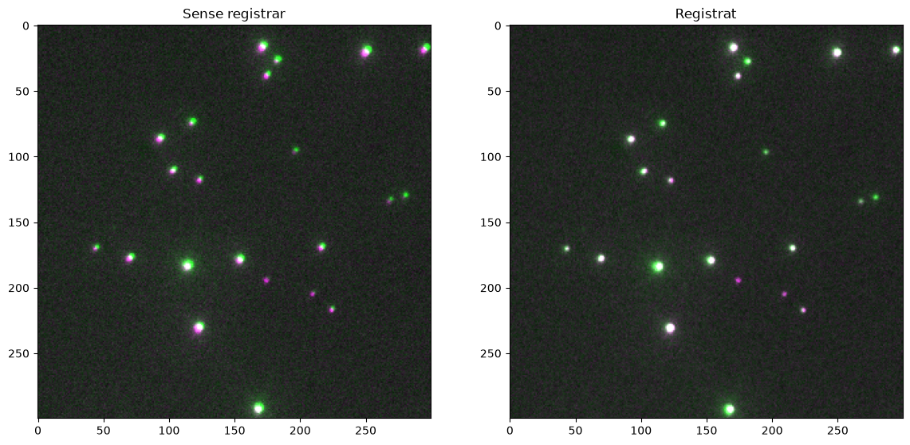
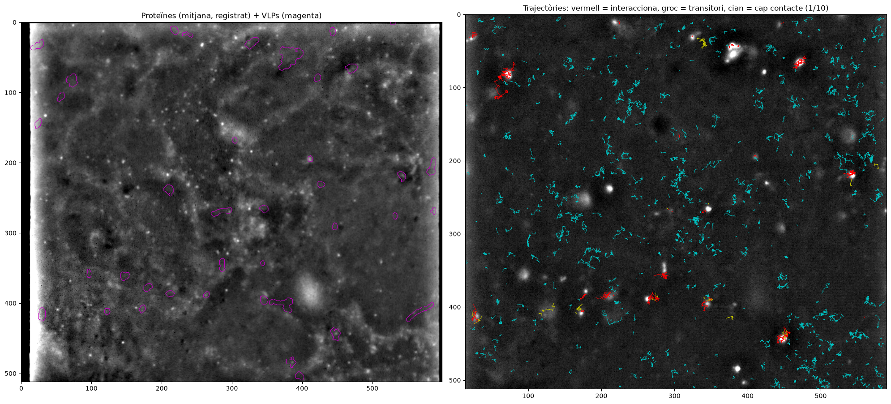
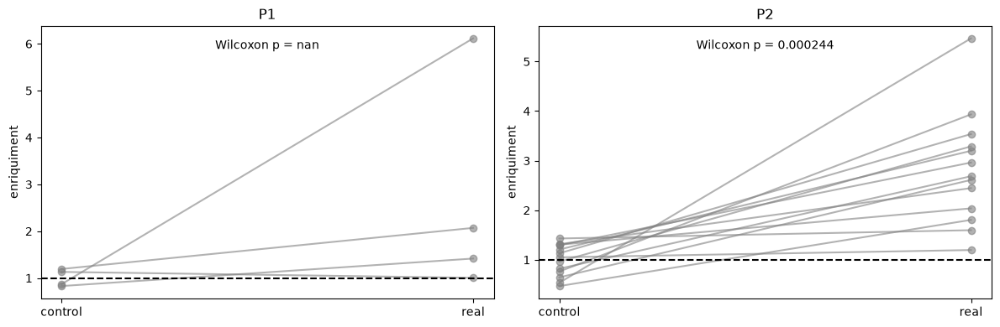
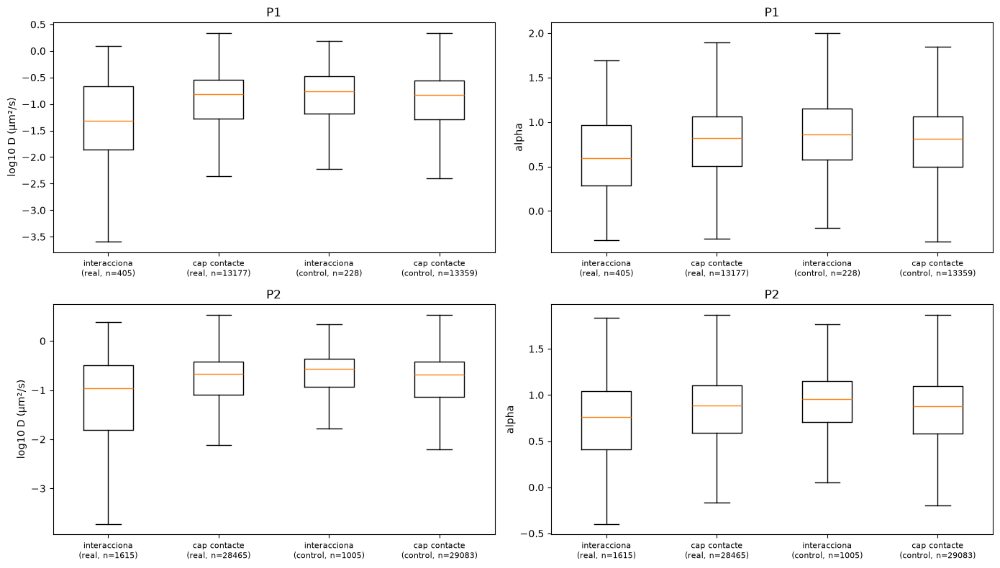
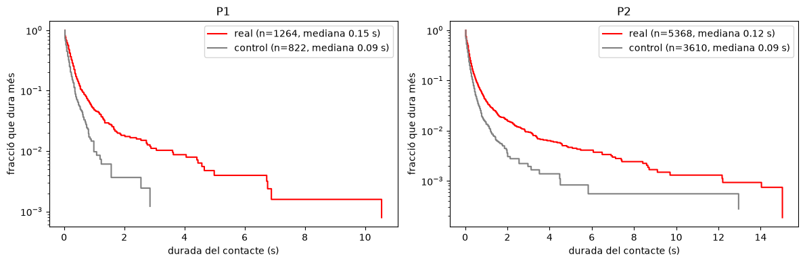

# VLP segmentation and Occludin–VLP interaction analysis

Single-particle tracking (SPT) analysis of HiLO microscopy movies with two channels: virus-like particles (VLPs) and Occludin-GFP (membrane protein). A UNet trained on simulated images segments the VLPs. The Occln trajectories are then classified by whether they touch a VLP, and their motion is compared with and without contact.

The whole pipeline is in [`Projecte_VLP_Proteins_final.ipynb`](Projecte_VLP_Proteins_final.ipynb).

## The data

Each frame is 512 × 1200 px and holds both channels side by side, split by an image splitter:



| | Left half (x < 600) | Right half (x > 600) |
|---|---|---|
| Content | VLPs | Occln |
| Appearance | Few bright, almost immobile spots | Many moving particles on a cell background |
| Input | Raw `.lif` movie | u-track results (`*_tracking.txt`) |

- **2 projects, 17 movies:** Project 1 has 4 movies, Project 2 has 13. Each has 500 frames at ~30 ms per frame, with a pixel size of 0.11 µm.
- **u-track results:** `seq_sXX/analysis/` holds the u-track output for LIF series `XX-1`.
- **Raw movies not included:** the `.lif` files (2.3 GB and 7.4 GB) are too large for GitHub.

## Pipeline

| Step | What it does | Notebook section |
|---|---|---|
| 1. Characterise real VLPs | Measures spot width (σ ≈ 1.56 px) and brightness (signal/noise ≈ 8–90) | 2 |
| 2. Simulate training data | DeepTrack images with matching PSF, brightness, background and noise, plus their masks | 3 |
| 3. Train a UNet | deeplay `UNet2d` trained on 2,000 simulated images | 4 |
| 4. Evaluate | Precision, recall and F1 on simulated test images to pick the probability threshold | 5 |
| 5. Segment real VLPs | Averages blocks of 5 frames, predicts masks, and links them in time so each VLP keeps one ID | 6 |
| 6. Register channels | Fits an affine transform from a bead image to map protein coordinates onto the VLP channel | 7 |
| 7. Classify contacts | Marks each protein position inside a VLP mask (+2 px tolerance) | 8 |
| 8. Compare behaviour | Compares diffusion coefficient D, exponent α, step sizes and contact durations, against a rotated control | 9–10 |

### Simulation vs real data

Real and simulated images are normalised the same way (background subtracted, divided by the noise), so the network sees the same kind of input in training and on real data:



### UNet predictions (simulated test images)

Rows: simulated image, true mask, predicted mask. Detection F1 ≈ 0.99 on simulated data.



### VLP masks on real data



### Channel registration with beads

Beads are visible in both channels. They are detected in each half, paired, and an affine transform is fitted with RANSAC (RMS error 0.74 px). The plot shows the left channel in magenta and the right channel in green; after registration the beads overlap and look white.



This is the same approach as [`register_channels.m`](register_channels.m), implemented with scikit-image. The same scheme is used in the `fiducialreg` module of [LLSpy](https://github.com/tlambert03/LLSpy) and in the scikit-image example [Robust matching using RANSAC](https://scikit-image.org/docs/stable/auto_examples/transform/plot_matching.html).

### Occln trajectories and contact

Red: interacts with a VLP (≥ 3 consecutive frames in contact). Yellow: brief contact. Cyan: no contact (1 in 10 shown).



## Control

To tell real VLP effects from chance, every analysis is repeated with the Occln positions **rotated 180°** inside the field. This keeps the density and motion of the proteins but removes any real spatial relation to the VLPs.

## Main results

**Occludin accumulates on VLPs.** In 16 of 17 movies, the density of Occln positions inside VLPs is higher than in the control. In two of them (P1 s03 and P2 s13) it stays close to the control value.



**Proteins in contact with VLPs move more slowly and are more confined.**

| | Project 1 | Project 2 |
|---|---|---|
| Median D, in contact | 0.048 µm²/s | 0.110 µm²/s |
| Median D, no contact | 0.153 µm²/s | 0.211 µm²/s |
| Median D, "in contact" in the control | 0.174 µm²/s | 0.268 µm²/s |
| Median α, in contact vs no contact | 0.59 vs 0.82 | 0.76 vs 0.89 |
| Mean contact duration, real vs control | 0.31 vs 0.16 s | 0.28 vs 0.17 s |



- **Every movie agrees.** The ratio D(in contact) / D(no contact) is lower in the real data than in the control in all 17 movies (Wilcoxon signed-rank across movies, p = 1.5·10⁻⁵).
- **The slowdown happens on the VLP.** Steps taken on a VLP are slower. Steps the same proteins take away from the VLP look like those of proteins that never touch one.
- **Contacts last longer than chance**, with a tail of events lasting several seconds:



### Statistics

- **Wilcoxon signed-rank (per movie):** the main test. Each movie is compared with its own control and counts as one replicate.
- **Mann-Whitney U (per trajectory):** describes how the distributions differ. Its p-values are inflated, because trajectories from the same movie aren't independent.

## Repository structure

```
Projecte_VLP_Proteins_final.ipynb   full pipeline (Catalan)
register_channels.m                 original MATLAB bead registration
split_trajs.m                       original MATLAB left/right trajectory split
20241026 ... Project 1/2 .../       u-track detection and tracking per movie
resultats/
  unet_vlp.pt                       trained UNet weights
  mascares/                         VLP label masks per movie (.npz)
  trajectories.csv                  per-trajectory D, alpha, class, contact fraction
  episodis_contacte.csv             every contact episode and its duration
  resum_series.csv                  per-movie summary (real and control)
docs/img/                           figures used in this README
```

## Running it

Main packages (versions used): `deeptrack` 2.0.2, `deeplay` 0.1.4, `torch` 2.13, `scikit-image` 0.26, `scipy`, `pandas`, `readlif`, `matplotlib`.

1. Put the two `.lif` files in the project folder.
2. Set `BASE` in the configuration cell to the project folder.
3. Run the notebook top to bottom.

- **Training:** takes about 15 minutes on a CPU. If `resultats/unet_vlp.pt` exists, the model is loaded instead of retrained.
- **Cached masks:** VLP masks are reused from `resultats/mascares/`. Delete that folder after changing any segmentation parameter (`PIC_MIN`, `MIN_BLOCS`, `BLOC`, threshold).

## Limitations

- **Project 2 has no bead image,** so it uses Project 1's registration (same day and setup).
- **Results depend on a few parameters:** the brightness cut-off for VLPs (`PIC_MIN`), the contact tolerance (`TOLERANCIA`, 2 px) and the minimum contact length (`MIN_CONTACTE`, 3 frames). How sensitive the results are to these has not been tested.
- **VLP masks are updated every 5 frames** (~0.15 s).

## References

- Fischler, M. A. & Bolles, R. C. (1981). Random sample consensus: a paradigm for model fitting with applications to image analysis and automated cartography. *Communications of the ACM*, 24(6), 381–395.
- van der Walt, S. et al. (2014). scikit-image: image processing in Python. *PeerJ*, 2, e453.
- Jaqaman, K. et al. (2008). Robust single-particle tracking in live-cell time-lapse sequences. *Nature Methods*, 5, 695–702 (u-track).
- [DeepTrack 2](https://github.com/DeepTrackAI/DeepTrack2) and [deeplay](https://github.com/DeepTrackAI/deeplay) for simulation and the UNet.
- [LLSpy](https://github.com/tlambert03/LLSpy): bead-based channel registration (`src/fiducialreg/fiducialreg.py`).
